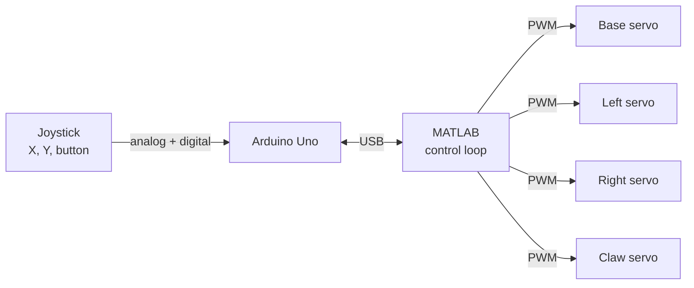

# 4-DOF Robotic Arm Control with Arduino & MATLAB

Real-time joystick control of a 3D-printed, four-servo robotic arm. MATLAB reads the joystick through an Arduino Uno and drives each joint with PWM, using a simple state machine to switch which joint the joystick controls.

*UNF Modeling & Simulation, Mini Project 2 (April 2026)*

📄 **[Full project report (PDF)](docs/Mini%20Project%202%20Report.pdf)**: wiring diagram, code walkthrough, and photos of the hardware

---

## Highlights

- **4 degrees of freedom:** base rotation, two arm joints, and a gripper claw
- **Human-machine interface:** analog joystick (X/Y) plus a push button to cycle joints
- **State-based control:** the button steps through Left → Right → Claw; the X-axis always rotates the base
- **Smooth motion:** inputs are normalized, scaled by a sensitivity gain, filtered by a dead zone, and clamped to safe limits
- **Custom hardware:** lightweight 3D-printed arm with SG90 micro servos

## Hardware

| Component | Qty |
|---|---|
| Arduino Uno | 1 |
| SG90 micro servo | 4 |
| Analog joystick module | 1 |
| 3D-printed arm structure | 1 |
| Breadboard + jumper wires | — |

### Pin map

| Device | Arduino pin |
|---|---|
| Base servo | D11 |
| Left servo | D10 |
| Right servo | D9 |
| Claw servo | D6 |
| Joystick VRx | A0 |
| Joystick VRy | A1 |
| Joystick button (SW) | D3 (internal pull-up) |

Servo wiring: Brown = GND, Red/Orange = 5V, Yellow = Signal.

The full wiring diagram (Figure 1) and a photo of the finished build (Figure 5) are in the [project report](docs/Mini%20Project%202%20Report.pdf).

## How it works

1. **Initialize:** connect to the Arduino, attach the four servos, enable the button's pull-up, and record the joystick's rest voltage.
2. **Read inputs:** sample X/Y voltages (0–5 V) and the button every loop.
3. **Switch state:** a button press (active low, debounced) cycles the Y-axis between the left joint, right joint, and claw.
4. **Update positions:** each axis is normalized around 2.5 V, ignored inside a small dead zone, and scaled by the sensitivity gain, then added to the joint position.
5. **Clamp & write:** positions are limited to safe ranges (the base is restricted to avoid a mechanical interference) and written to the servos.

## Running it

1. Install MATLAB and the **MATLAB Support Package for Arduino Hardware**.
2. Wire the hardware using the pin map above and connect the Uno over USB.
3. Open [`src/miniProject_02.m`](src/miniProject_02.m) and run it. Keep the joystick centered during the 1-second calibration.
4. Push the joystick left/right to rotate the base; press the button to choose a joint, then push up/down to move it.

## Challenges

- **Joystick noise:** the analog readings jitter around center, which was handled with a dead-zone threshold so the arm holds still when the stick is released.
- **Mechanical limits:** the base joint's range had to be restricted in software to keep the printed structure from binding.

## Possible improvements

- Use the calibrated center voltages instead of a fixed 2.5 V reference
- Add a moving-average filter for smoother input
- Run the control loop on the Arduino itself (C++) for lower latency, using MATLAB only for monitoring
- Add inverse kinematics for point-to-point moves

## Team

Ahmad Kawook · Donovan James · Christopher Rains, University of North Florida

**Skills:** MATLAB · Arduino · embedded systems · PWM servo control · state machines · 3D printing
